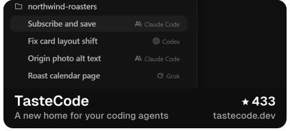
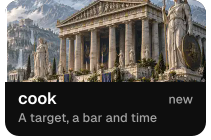

<a href="https://tasteskill.dev">tasteskill.dev</a> &nbsp;·&nbsp; <a href="https://tastecode.dev">tastecode.dev</a> &nbsp;·&nbsp; <a href="https://leonlin.de">leonlin.de</a> &nbsp;·&nbsp; <a href="https://x.com/lexnlin">@lexnlin</a> &nbsp;·&nbsp; <a href="mailto:hello@tasteskill.dev">hello@tasteskill.dev</a>

Taste Skill stays free because of them

<a href="https://interfaces.dev/?utm_source=tasteskill&utm_medium=sponsorship"><picture><source media="(prefers-color-scheme: dark)" srcset="assets/profile/sponsor-interfaces-dark.svg"></picture></a><a href="https://reactbits.dev"><picture><source media="(prefers-color-scheme: dark)" srcset="assets/profile/sponsor-reactbits-dark.svg"></picture></a><a href="https://img.ly/"><picture><source media="(prefers-color-scheme: dark)" srcset="assets/profile/sponsor-imgly-dark.svg"></picture></a><a href="https://www.sent.dm"><picture><source media="(prefers-color-scheme: dark)" srcset="assets/profile/sponsor-sentdm-dark.svg"></picture></a>

Open source support from <a href="https://platform.kimi.ai?track_id=track-20f0d64bcaba419bb425a3e8c306f65d&aff=taste-skill">Kimi</a> (10% bonus API credits through this link) and the <a href="https://vercel.com/open-source-program">Vercel Open Source Program</a> &nbsp;·&nbsp; <a href="https://github.com/sponsors/Leonxlnx">Become a sponsor</a>

